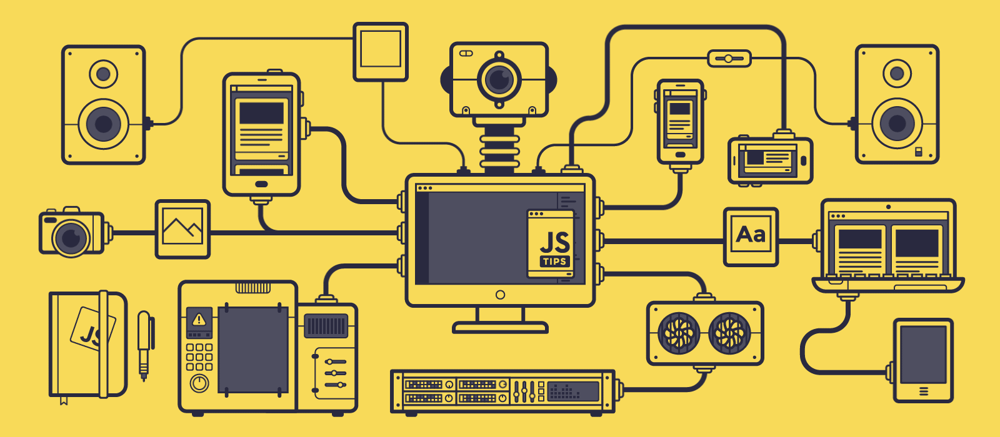
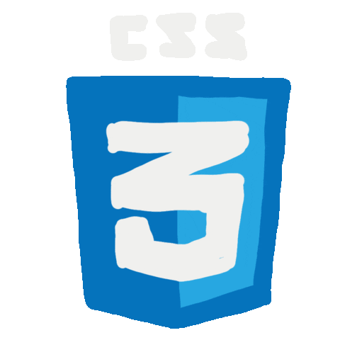

<div align="center">
  <samp>
    <h1>Make Life Easier|Look through Lens|Entertain by GAMES</h1>
  </samp>
</p>

<div align="center">
  <samp>
    <h2>Hi  I'm Daiyan Rahman</h2>

  </samp>
</p>

### Frontend Developer • Love to play GAMEAS • Photographer • UI/UX 

 

*Currently coding modern user experiences and engineering electronics projects ✨*
*Still learn the Languages mentined  ✨*


##  About Me 
<div align="left">
- 🌐 Frontend Developer: Crafting clean, responsive, and user-friendly web experiences.
- 🎮 Gamer: Passionate about exploring immersive games and virtual worlds.
- 📸 Photographer: Capturing moments through the lens with Daiyan Studio.
- 🎨 UI/UX Enthusiast: Designing intuitive, aesthetic, and user-centered interfaces.
- 🎯 Goal: I love combining software, hardware, and photography to bring creative ideas to life.
</div>
</div>

###  Tech Stack & Tools


<a href="https://www.overleaf.com/project">

</a>
<a href="https://www.overleaf.com/project">

</a>
<a href="https://www.photocrowd.com/daiyan/">

</a>
<a href="https://www.photocrowd.com/daiyanrahman/">

</a>

---

### 🎨 Creative & Showcase

<table align="center" width="100%">
  <tr>
    <td align="center" width="50%">
      
    </td>
    <td align="center" width="50%">
      
    </td>
  </tr>
</table>

---
<div align="left">
 <h1> Featured Projects & Engineering Showcase</h1>
</div>

---

### 💻 DSAhub – Dynamic DSA Practice & Execution Platform
> **A zero-dependency, client-side algorithmic learning platform featuring 30+ interactive challenges, multi-language sandbox execution, real-time code tools, and peer community discussion.**

[](https://github.com/DAiyan582/DSA_HUB)
[]()
[]()
[-f59e0b?style=flat-square)]()

#### 🚀 Key Highlights & What I Built
- **Dynamic Algorithmic Question Bank:** Curated 30+ comprehensive Data Structures & Algorithms problems organized across core topics (Arrays, Strings, Trees, Dynamic Programming, Graphs) with instant multi-facet search, difficulty filters, and custom sorting.
- **Integrated Multi-Language Code Runner:** Built an in-browser code editor and runner powered by the **Piston API**, supporting compilation and execution across 15+ programming languages with syntax highlighting, live line counting, automatic formatting, download, and snippet sharing.
- **Client-Side Auth & Gamified Progress:** Developed a zero-backend authentication workflow with validation; utilizes `localStorage` for state persistence to track solved challenges, maintain daily streaks, manage problem bookmarks, and award profile badges.
- **Collaborative Community Hub:** Integrated peer discussion boards for algorithmic time/space complexity debates, peer code reviews, and competitive leaderboard tracking.
- **Responsive Ergonomic UI/UX:** Designed with dark/light themes, distraction-free reading mode, custom editor typography, pagination, toast notifications, and power-user keyboard shortcuts.

<details>
<summary>🛠️ <b>Tech Stack & Architecture</b></summary>

- **Frontend:** HTML5 · CSS3 · Vanilla JavaScript (ES6+)
- **Storage & State:** Web Storage API (`localStorage`) for zero-server state management
- **Execution Engine:** [Piston API](https://github.com/engineer-man/piston) for real-time sandbox code execution
- **Design Philosophy:** Mobile-responsive, zero build dependencies, 100% portable
</details>

<details>
<summary>▶️ <b>How to Run Locally</b></summary>

```bash
# 1. Clone the repository
git clone https://github.com/DAiyan582/DSA_HUB.git

# 2. Launch directly in your browser
# Double-click or open 'update-06-LOGIN.html' in Google Chrome, Edge, or Firefox.
# No node_modules, webpack, or external web servers required!
```
</details>

---

### 🏏 Cricket Match Simulator (C) – 50-Overs ODI Simulation Engine
> **A high-fidelity console-based 50-over cricket simulation engine with dynamic batting lineups, stochastic event distribution, real-time live match telemetry, and automated scorecard export.**

[](https://github.com/DAiyan582/Cricket-Game)
[]()
[]()
[]()

#### 🏆 Academic Recognition
- **A-Grade Academic Project:** Commended for advanced procedural programming, algorithmic state management, pointer-based data modeling, and robust file I/O streaming.

#### 🚀 Key Highlights & What I Built
- **Realistic Innings & Batting Order State Machine:** Models an entire 50-over (up to 300 deliveries) innings or 10-wicket threshold; dynamically handles striker/non-striker rotations, partnerships, and automatic batsman substitutions upon dismissal.
- **Probabilistic Event Distribution Engine:** Uses mathematical randomization logic to simulate authentic match dynamics: dot balls, singles, doubles, boundaries (4s & 6s), bowling extras (wides/no-balls), and 5 distinct dismissal types (Bowled, Caught, LBW, Run Out, Stumped).
- **Live Match Telemetry & Statistics:** Continuously recalculates strike rates, balls faced, boundary counts, team run rate, and active bowler figures delivery-by-delivery in real time.
- **Comprehensive Player Tracking:** Maintains complete statistics across all 11 batsmen, computing runs, strike rate, boundaries, and precise dismissal records.
- **Automated Scorecard File Export:** Formats and writes clean ASCII tabular match summaries to `scorecard.txt` using buffered C file I/O operations (`fopen`, `fprintf`).

<details>
<summary>🛠️ <b>Tech Stack & Concepts</b></summary>

- **Language:** C (C99 Standard)
- **Core Concepts:** `struct` data modeling, dynamic pointers, file stream I/O (`stdio.h`), time-seeded randomization (`stdlib.h`, `time.h`)
- **System Design:** Deterministic state machine, algorithmic probability weighting, modular function architecture
</details>

<details>
<summary>▶️ <b>Compilation & Execution</b></summary>

```bash
# 1. Clone the repository
git clone https://github.com/DAiyan582/Cricket-Game.git

# 2. Compile the simulation with GCC
gcc PROJECT.c -o cricket_simulator

# 3. Run the simulator
./cricket_simulator
```
</details>

<details>
<summary>📝 <b>Sample Generated Scorecard (scorecard.txt)</b></summary>

```text
================================================================================
                         50-OVERS ODI MATCH SCORECARD                           
================================================================================
Team: Bangladesh
Total: 268/7 in 50.0 overs (RR: 5.36)
================================================================================
Batsman              Runs     Balls     4s     6s       SR     Status
--------------------------------------------------------------------------------
Tamim Iqbal           42        51      5      1     82.35     c Caught
Litton Das            18        24      2      0     75.00     b Bowled
Shakib Al Hasan       89       104      9      2     85.57     Not Out
Mushfiqur Rahim       54        62      4      1     87.10     c Caught
Mahmudullah           27        31      2      1     87.09     Run Out
Afif Hossain          14        16      1      0     87.50     lbw
Mehidy Hasan          11         9      1      0    122.22     c Caught
Taskin Ahmed           4         3      0      0    133.33     Not Out
--------------------------------------------------------------------------------
[✓] Match summary successfully saved to 'scorecard.txt'.
```
</details>

---

### 🤖 Smart Agribot – IoT & Microcontroller-Based Precision Agriculture Rover
> **An autonomous Arduino Nano-driven agricultural field rover engineered to mechanize 4 fundamental farming operations—seed sowing, pesticide spraying, weed cutting, and field navigation—via wireless Bluetooth telemetry.**

[](https://github.com/DAiyan582/EEE-project)
[-ffd700?style=flat-square&logo=award&logoColor=black)]()
[]()
[]()

#### 🏆 Academic Recognition
- **Top-Performing Project – Electronics Laboratory (EEE 2124):** Selected as a standout hardware-software capstone across the entire batch for excellence in embedded systems architecture, circuit schematics, and multi-actuator robotics.

#### 🚀 Key Highlights & What I Built
- **High-Torque 4WD Robotic Chassis:** Designed and constructed an all-terrain 4-wheel drive rover powered by 4 geared DC motors and an L298N dual H-bridge motor driver, providing robust forward, reverse, and differential steering across uneven field terrain.
- **Servo-Actuated Precision Seed Sowing:** Engineered a calibrated seed dispensing mechanism driven by a high-precision micro-servo motor, ensuring accurate angular discharge for uniform seed spacing and soil depth.
- **Relay-Isolated Pesticide Spraying Unit:** Integrated a 5V DC high-pressure mini pump routed through a dual-channel optocoupled relay module to deliver uniform liquid pesticide and fertilizer misting over crop beds.
- **Motorized Weed & Grass Cutting Blade:** Implemented a high-RPM cutting motor operated via dedicated relay switching to perform weed control and ground maintenance.
- **Wireless Telemetry & Bluetooth Control:** Integrated an HC-05 Bluetooth transceiver interfacing with a custom smartphone app, enabling wireless remote control of rover movement, seed sowing, spraying, and cutting.
- **Regulated Dual-Rail Power Distribution:** Engineered an onboard power management circuit utilizing rechargeable 18650 Li-ion cells and a buck step-down converter to deliver clean, surge-protected 5V/3.3V power to the MCU and inductive motor loads.

<details>
<summary>🛠️ <b>Tech Stack & Hardware Components</b></summary>

- **Microcontroller:** Arduino Nano (ATmega328P)
- **Actuators & Drivers:** 4x Geared DC Motors, L298N Dual H-Bridge Driver, SG90 Micro Servo, High-RPM Cutting Motor, 5V DC Pump Motor
- **Sensors & Wireless:** HC-05 Bluetooth Module (UART Serial Communication)
- **Power & Circuitry:** 18650 Li-ion Battery Pack, LM2596 Buck Converter, 2-Channel 5V Relay Module, Proteus CAD Simulation
- **Firmware:** Embedded C++ (Arduino IDE)
</details>

<details>
<summary>▶️ <b>Firmware Setup & Hardware Wiring</b></summary>

```text
1. Clone the repository: https://github.com/DAiyan582/EEE-project.git
2. Open the .ino sketch in Arduino IDE.
3. Connect Arduino Nano via USB and select 'Arduino Nano' and COM port.
4. Verify pin configurations (L298N IN1-IN4, Servo signal, Relay IN1-IN2, HC-05 RX/TX).
5. Compile and upload firmware. Pair via mobile Bluetooth app to operate rover.
```
</details>

---

### 🚍 UIU Go! – Smart Campus Bus Tracking & Transit Management System
> **A GPS-enabled transit tracking and campus mobility platform engineered for United International University, unifying live bus telematics, dynamic route mapping, predictive delay notifications, and administrative fleet analytics.**

[](https://github.com/DAiyan582/UIU-BUS-TRACKING)
[-ffd700?style=flat-square&logo=award&logoColor=black)]()
[]()
[]()

#### 🏆 Academic Recognition
- **Top Academic Project – System Analysis & Design (SAD):** Honored for end-to-end Software Requirements Specification (SRS), comprehensive UML architectural diagrams, user-centric interface design, and real-world campus transit problem-solving.

#### 🚀 Key Highlights & What I Built
- **Real-Time Bus Tracking & Geospatial Mapping:** Built live location tracking flows integrated with Google Maps JavaScript API, showing dynamic bus movement, route waypoints, pickup stops, and precise student arrival ETAs.
- **Dual-Role Driver & Administrator Dashboards:** Designed distinct control panels—an intuitive driver interface for one-tap GPS location broadcasting, and an admin console for fleet dispatch, schedule updates, and live route status.
- **Predictive Delay & Notification Dispatcher:** Developed an automated notification engine that alerts commuters to traffic bottlenecks, route diversions, weather hold-ups, and timetable changes in real time.
- **Responsive Mobile-First UI/UX:** Designed and tested high-fidelity interactive prototypes in Figma for both mobile web and desktop devices, optimizing for student commute ergonomics.
- **Transit Telematics & Ridership Analytics:** Integrated Chart.js data visualization tools to monitor commuter volume, peak-hour bottlenecks, and route efficiency patterns.
- **Scalable Enterprise Architecture & UML Modeling:** Authored complete architectural specifications including Context Diagrams, Use-Case Specifications, Activity Diagrams, Data Flow Diagrams (DFD Level 0-2), Class Hierarchies, and CRC Cards.

<details>
<summary>🛠️ <b>Tech Stack & Design Tools</b></summary>

- **UI/UX & Prototyping:** Figma (Interactive Wireframes, Components, User Journey Maps)
- **APIs & Visualization:** Google Maps JavaScript API, Chart.js Data Visualization
- **Systems Engineering:** UML Diagrams (Use-Case, DFD Level 0-2, Activity, Class, CRC), SRS Documentation (IEEE 830 Standard)
- **Frontend Concepts:** Responsive Layouts, Geolocation API, Event-Driven Notification Workflows
</details>

<details>
<summary>▶️ <b>Project Assets & Specification Access</b></summary>

```text
Repository: https://github.com/DAiyan582/UIU-BUS-TRACKING
Explore complete Figma design prototypes, UML system architecture diagrams, 
and IEEE-standard SRS documentation in the repository repository assets.
```
</details>

---

### 🏠 Tenant Management System (TMS) – Integrated Property & Rental Platform
> **A centralized property and rental platform streamlining tenant onboarding, automated rent tracking, maintenance ticketing, and financial dashboards, built with Agile (Scrum) methodologies.**

[](https://github.com/DAiyan582/MY-Prrvious-Projects/blob/main/TMS_REPORT_FOR_PMG.pdf)
[]()
[-0052CC?style=flat-square&logo=jira&logoColor=white)]()

#### 🚀 Key Highlights & What I Built
- **Tenant & Property Lifecycle Management:** Engineered structured workflows for digital rental applications, background screening, electronic lease agreements, and centralized tenant profiles.
- **Automated Financial Tracking & Alerts:** Outlined automated rent reminder schedules, real-time payment tracking, fee reconciliation, and financial health reporting for property managers.
- **Maintenance Request Ticketing Pipeline:** Designed end-to-end service ticket lifecycles—tenant creation, status notifications, contractor assignment, and historical repair logs.
- **Unified Stakeholder Communication:** Created specifications for in-app announcements, lease dispute resolution, and document archives.
- **Comprehensive Project Management Engineering:** Formulated complete project planning artifacts including Work Breakdown Structure (WBS), Wideband Delphi estimations, COCOMO II cost calculations, Function Point Analysis (FPA), and RMMM risk mitigation matrices.

<details>
<summary>🛠️ <b>Project Management & Engineering Stack</b></summary>

- **Methodologies:** Agile (Scrum), Sprint Planning, SDLC Lifecycle Management
- **Estimation Models:** COCOMO II, Function Point Analysis (FPA), Wideband Delphi
- **Tools & Tracking:** Jira, WBS & Gantt Charting, RMMM Risk Matrices, CMMI Quality Guidelines
</details>

---

### 📱 SMISHING Detector – Hybrid AI Model for Real-Time SMS Phishing & Spam Defense
> **A production-ready cybersecurity solution leveraging a dual-input hybrid deep learning architecture (1D-CNN + TF-IDF) to detect SMS phishing and spam across English and Bangla datasets with 93.17% accuracy, backed by a real-time Flask web detector and automated bulk batch analysis.**

[](https://github.com/DAiyan582/Computer-Security)
[]()
[]()
[-ffd700?style=flat-square&logo=award&logoColor=black)]()
[]()

#### 🏆 Academic Recognition
- **Top Academic Project – Machine Learning & Deep Learning:** Recognized for outstanding hybrid neural network design, cross-lingual dataset curation (English + Bangla), and end-to-end production pipeline achieving **93.17% Accuracy** and **92.19% F1-Score**.

#### 🧠 1. Model Architecture & Dual-Input Engineering
- **Hybrid Neural Network Architecture:** Built using TensorFlow/Keras Functional API; combines a 1D Convolutional Neural Network (CNN for extracting sequential semantic patterns and local n-gram text dependencies) with a dense TF-IDF branch (capturing global lexical frequency distributions).
- **Dual-Branch Feature Fusion:** Merged CNN-processed sequence embeddings with dense TF-IDF vectors into a shared dense classification head, drastically minimizing false alarms on ambiguous texts.
- **End-to-End Model Lifecycle:** Managed dataset curation, hyperparameter optimization, dropout regularization, model checkpointing, and serialization (`.h5` weights and `pickle` vectorizer binaries).

#### 📊 2. Multilingual Data Preprocessing & Pipeline
- **Cross-Lingual Corpus (5,679 Messages):** Unified 6 disparate English and Bangla SMS datasets into a single balanced benchmark corpus to counter regional phishing vectors.
- **Automated Text Sanitization:** Engineered regex cleaning pipelines to normalize Unicode characters, strip noise, handle punctuation, and sanitize language-specific scripts for both CNN tokenization and TF-IDF extraction.
- **Sequence Padding & Tokenization:** Standardized input sequences with Keras `Tokenizer` and `pad_sequences` to ensure zero data leakage across train/validation/test splits.

#### 💻 3. Real-Time Application & Deployment
- **Interactive Web Detector:** Developed a modern, responsive HTML5/JS interface connected to a Flask REST API, allowing users to input SMS text and receive instant SPAM/LEGITIMATE classifications with confidence percentages.
- **High-Throughput Batch Processing:** Engineered Python batch processing scripts capable of evaluating bulk CSV/Excel files (150+ messages per run), generating color-coded HTML reports and exportable CSVs with summary statistics (spam rate, distribution breakdown).
- **Low-Latency API Endpoints:** Implemented lightweight `/predict` and `/health` REST routes ensuring rapid sub-second inference.

#### 📈 4. Performance Analytics & Visualization
- **Convergence & Loss Diagnostics:** Generated epoch-by-epoch training/validation accuracy and loss curves via Matplotlib, ensuring rapid convergence and preventing overfitting.
- **Diagnostic HTML Reports:** Automated generation of visual tables highlighting predictions by confidence thresholds, aiding cybersecurity threat analysis.
- **Verified Benchmark Metrics:**
  - **Accuracy:** `93.17%`
  - **F1-Score:** `92.19%`
  - **Precision & Recall:** Balanced to prevent legitimate SMS misclassification.

<details>
<summary>🛠️ <b>Tech Stack & Libraries</b></summary>

- **Deep Learning & ML:** TensorFlow 2.x, Keras (Functional API), Scikit-Learn
- **Core Architecture:** 1D-CNN (Sequential Embeddings), TF-IDF Vectorizer (Lexical Frequencies)
- **Backend & API:** Python 3.x, Flask RESTful API
- **Data & Visualization:** Pandas, NumPy, Matplotlib
- **Frontend UI:** HTML5, Modern CSS3, JavaScript (Fetch API)
</details>

<details>
<summary>▶️ <b>How to Run the SMS Detector</b></summary>

```bash
# 1. Clone the repository
git clone https://github.com/DAiyan582/Computer-Security.git
cd Computer-Security

# 2. Install required packages
pip install tensorflow flask scikit-learn pandas numpy matplotlib

# 3. Launch the Flask web detector
python app.py

# 4. Open in browser: http://127.0.0.1:5000
```
</details>

</div>

<div align="left">
<h1>🛠️ Tech Stack & Tools (Frontend-Development)</h1>

<table align="center">
  <tr>
    <td align="center" width="120" height="120" bgcolor="#0d1117" style="border: 2px solid #3b82f6; border-radius: 8px; padding: 15px;">
      <br/>
      <span style="color: #ffffff; font-family: sans-serif; font-size: 13px; font-weight: bold; display: block; margin-top: 12px;">HTML5</span>
    </td>
    <td align="center" width="120" height="120" bgcolor="#0d1117" style="border: 2px solid #3b82f6; border-radius: 8px; padding: 15px;">
      <br/>
      <span style="color: #ffffff; font-family: sans-serif; font-size: 13px; font-weight: bold; display: block; margin-top: 12px;">CSS3</span>
    </td>
    <td align="center" width="120" height="120" bgcolor="#0d1117" style="border: 2px solid #3b82f6; border-radius: 8px; padding: 15px;">
      <br/>
      <span style="color: #ffffff; font-family: sans-serif; font-size: 13px; font-weight: bold; display: block; margin-top: 12px;">JavaScript</span>
    </td>
    <td align="center" width="120" height="120" bgcolor="#0d1117" style="border: 2px solid #3b82f6; border-radius: 8px; padding: 15px;">
      <br/>
      <span style="color: #ffffff; font-family: sans-serif; font-size: 13px; font-weight: bold; display: block; margin-top: 12px;">Python</span>
    </td>
    <td align="center" width="120" height="120" bgcolor="#0d1117" style="border: 2px solid #3b82f6; border-radius: 8px; padding: 15px;">
      <br/>
      <span style="color: #ffffff; font-family: sans-serif; font-size: 13px; font-weight: bold; display: block; margin-top: 12px;">Arduino</span>
    </td>
  </tr>
  
  <tr>
    <td align="center" width="120" height="120" bgcolor="#0d1117" style="border: 2px solid #3b82f6; border-radius: 8px; padding: 15px;">
      <br/>
      <span style="color: #ffffff; font-family: sans-serif; font-size: 13px; font-weight: bold; display: block; margin-top: 12px;">Figma</span>
    </td>
    <td align="center" width="120" height="120" bgcolor="#0d1117" style="border: 2px solid #3b82f6; border-radius: 8px; padding: 15px;">
      <br/>
      <span style="color: #ffffff; font-family: sans-serif; font-size: 13px; font-weight: bold; display: block; margin-top: 12px;">VS Code</span>
    </td>
    <td align="center" width="120" height="120" bgcolor="#0d1117" style="border: 2px solid #3b82f6; border-radius: 8px; padding: 15px;">
      <br/>
      <span style="color: #ffffff; font-family: sans-serif; font-size: 13px; font-weight: bold; display: block; margin-top: 12px;">Git Bash</span>
    </td>
    <td align="center" width="120" height="120" bgcolor="#0d1117" style="border: 2px solid #3b82f6; border-radius: 8px; padding: 15px;">
      <br/>
      <span style="color: #ffffff; font-family: sans-serif; font-size: 13px; font-weight: bold; display: block; margin-top: 12px;">GitHub</span>
    </td>
    <td align="center" width="120" height="120" bgcolor="#0d1117" style="border: 2px solid #3b82f6; border-radius: 8px; padding: 15px;">
      <br/>
      <span style="color: #ffffff; font-family: sans-serif; font-size: 13px; font-weight: bold; display: block; margin-top: 12px;">Overleaf</span>
    </td>
  </tr>

  <tr>
    <td align="center" width="120" height="120" bgcolor="#0d1117" style="border: 2px solid #3b82f6; border-radius: 8px; padding: 15px;">
      <br/>
      <span style="color: #ffffff; font-family: sans-serif; font-size: 13px; font-weight: bold; display: block; margin-top: 12px;">LaTeX</span>
    </td>
    <td style="border: none;"></td>
    <td style="border: none;"></td>
    <td style="border: none;"></td>
    <td style="border: none;"></td>
  </tr>
</table>


</div>

<div align="left">

## 🗃️ GitHub Activity

</div>
<p align="center">
  
  <span>&nbsp;&nbsp;&nbsp;</span>
  
</p>
<p align="center">
  <!-- Live Contribution Line Graph -->
  
</p>

<div align="left">

## 🤝 Connect with me 

</div>

<p align="center">
  <!-- Facebook Link -->
  <a href="https://www.facebook.com/profile.php?id=100019019676325" target="_blank">
    
  </a>
  &nbsp;&nbsp;&nbsp;&nbsp;
  <!-- Instagram Link -->
  <a href="https://www.instagram.com/d_cikada3301/?__pwa=1#" target="_blank">
    
  </a>
  &nbsp;&nbsp;&nbsp;&nbsp;
  <!-- Gmail Link -->
  <a href="mailto:daiyanrahman900@gmail.com">
    
  </a>
</p>

